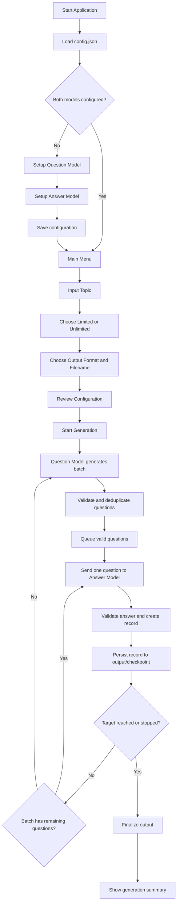

# PRD — Dual-Model Question & Answer Dataset Generator

**Nama proyek:** Dual-Model Dataset Generator  
**Versi dokumen:** 1.0  
**Status:** Draft — MVP  
**Jenis aplikasi:** CLI interaktif / TUI  
**Tujuan utama:** Menghasilkan dataset pertanyaan dan jawaban secara otomatis menggunakan dua model AI yang memiliki tanggung jawab terpisah.

---

## 1. Ringkasan Produk

Dual-Model Dataset Generator adalah aplikasi CLI/TUI yang membantu pengguna membuat dataset Question & Answer (Q&A) dari sebuah topik.

Aplikasi wajib menggunakan **dua model AI yang berbeda peran**:

1. **Question Model** — hanya bertugas membuat pertanyaan berdasarkan topik dan instruksi pengguna. Model ini tidak boleh menghasilkan jawaban.
2. **Answer Model** — hanya bertugas menjawab pertanyaan yang telah dibuat oleh Question Model.

Alur utamanya adalah:

1. Pengguna mengatur koneksi API untuk kedua model.
2. Konfigurasi disimpan secara lokal agar tidak perlu diatur ulang setiap kali aplikasi dijalankan.
3. Pengguna memasukkan topik.
4. Pengguna menentukan jumlah data atau memilih mode tanpa batas.
5. Pengguna memilih format output dan nama file.
6. Aplikasi menghasilkan pertanyaan terlebih dahulu.
7. Setiap pertanyaan kemudian dikirim satu per satu ke Answer Model.
8. Pertanyaan dan jawaban disimpan ke file output yang sama.
9. Proses dapat dihentikan kapan saja menggunakan `Ctrl+C`, tanpa kehilangan data yang sudah berhasil disimpan.

Produk difokuskan pada aplikasi lokal yang sederhana, mudah digunakan, dapat dikonfigurasi, dan dapat diperluas.

## 2. Masalah yang Ingin Diselesaikan

Pembuatan dataset Q&A secara manual membutuhkan waktu, terutama ketika pengguna membutuhkan banyak variasi pertanyaan dan jawaban dalam satu topik.

Penggunaan satu model untuk membuat pertanyaan sekaligus menjawabnya juga membuat pemisahan tugas kurang jelas. Proyek ini memisahkan proses tersebut agar:

- Pertanyaan dan jawaban dibuat melalui dua tahap yang berbeda.
- Pengguna dapat memilih model yang paling sesuai untuk masing-masing tugas.
- Hasil dapat disimpan dalam format terstruktur.
- Proses pembuatan dataset dapat dijalankan dalam jumlah besar.
- Konfigurasi model dapat digunakan kembali tanpa setup berulang.

## 3. Tujuan Produk

### 3.1 Tujuan MVP

- Menyediakan CLI/TUI interaktif.
- Mendukung dua konfigurasi model independen.
- Mendukung API yang kompatibel dengan format OpenAI Chat Completions melalui `base_url`, API key, dan model ID.
- Menyimpan konfigurasi model secara persisten dalam file JSON.
- Menghasilkan pertanyaan berdasarkan topik.
- Mengirim pertanyaan ke model kedua untuk dijawab satu per satu.
- Menyimpan pasangan pertanyaan dan jawaban dalam satu file output.
- Mendukung jumlah data terbatas dan mode tanpa batas.
- Mendukung ekspor JSON, JSONL, CSV, dan XLSX.
- Menangani `Ctrl+C` dengan aman dan mempertahankan data yang sudah tersimpan.

### 3.2 Bukan Tujuan MVP

- Membuat antarmuka web atau desktop GUI.
- Melatih atau melakukan fine-tuning model.
- Mengelola dataset melalui database server.
- Menjalankan banyak Answer Model secara paralel.
- Mendukung seluruh provider AI dengan format API khusus yang belum kompatibel dengan OpenAI.
- Menyediakan sistem login, multi-user, atau cloud synchronization.

## 4. Target Pengguna

- Developer yang membutuhkan dataset untuk eksperimen AI.
- Peneliti atau pelajar yang membutuhkan kumpulan Q&A.
- Pembuat knowledge base atau data pelatihan.
- Pengguna yang ingin membuat dataset berdasarkan topik tertentu dalam jumlah besar.

## 5. Konsep dan Terminologi

| Istilah | Definisi |
|---|---|
| Question Model | Model yang bertugas menghasilkan pertanyaan saja. |
| Answer Model | Model yang bertugas menjawab pertanyaan saja. |
| Topic | Topik utama yang menjadi dasar pembuatan pertanyaan. |
| Record | Satu item data yang berisi pertanyaan dan jawaban. |
| Batch | Sekumpulan pertanyaan yang dihasilkan dalam satu permintaan ke Question Model. |
| Target Count | Jumlah record Q&A yang ingin dihasilkan pengguna. |
| Unlimited Mode | Mode pembuatan data yang terus berjalan sampai dihentikan pengguna. |
| Checkpoint | Data sementara yang telah berhasil dibuat dan disimpan selama proses berjalan. |

## 6. User Flow

### 6.1 Startup dan Setup Model

Ketika aplikasi dijalankan:

1. Aplikasi membaca file konfigurasi lokal.
2. Jika konfigurasi belum tersedia, aplikasi meminta pengguna melakukan setup.
3. Jika konfigurasi sudah tersedia, aplikasi menampilkan status konfigurasi dan langsung menyediakan menu utama.
4. Pengguna dapat mengubah konfigurasi kapan saja melalui menu setup.

Menu utama setelah startup:

```text
╔══════════════════════════════════════════════╗
║          DUAL-MODEL DATASET GENERATOR        ║
╠══════════════════════════════════════════════╣
║  Question Model : Configured                 ║
║  Answer Model   : Configured                 ║
╠══════════════════════════════════════════════╣
║  [1] Setup Question Model                    ║
║  [2] Setup Answer Model                      ║
║  [3] Start Dataset Generation                ║
║  [4] View Current Configuration              ║
║  [5] Exit                                    ║
╚══════════════════════════════════════════════╝
Select an option:
```

Jika salah satu model belum dikonfigurasi, opsi `Start Dataset Generation` harus dinonaktifkan atau menampilkan pesan bahwa kedua model wajib dikonfigurasi terlebih dahulu.

### 6.2 Setup Model

Setup Question Model dan Answer Model menggunakan struktur input yang sama, tetapi disimpan pada bagian konfigurasi yang berbeda.

Field yang diminta:

| Field | Wajib | Keterangan |
|---|---:|---|
| Base URL | Ya | Endpoint API provider. |
| API Key | Ya | Credential untuk autentikasi. |
| Model ID | Ya | Nama atau ID model yang akan digunakan. |

Contoh tampilan:

```text
Setup Question Model

Base URL : https://api.example.com/v1
API Key  : ********
Model ID : provider/model-name

[1] Test Connection
[2] Save Configuration
[3] Cancel
```

Ketentuan:

- API key harus disembunyikan saat diketik dan saat ditampilkan kembali.
- Pengguna dapat menguji koneksi sebelum menyimpan konfigurasi.
- Aplikasi harus memberikan pesan error yang jelas jika koneksi gagal.
- Konfigurasi yang sudah ada dapat diedit.
- Jangan menimpa konfigurasi lama jika pengujian atau penyimpanan konfigurasi baru gagal.
- Pengujian koneksi tidak boleh mengasumsikan semua provider mendukung endpoint atau format yang sama. MVP menggunakan endpoint kompatibel OpenAI dan mendokumentasikan batasan tersebut.

### 6.3 Penyimpanan Konfigurasi

Konfigurasi disimpan secara lokal, misalnya pada:

```text
~/.dual-model-generator/config.json
```

Contoh struktur:

```json
{
  "version": 1,
  "question_model": {
    "base_url": "https://api.example.com/v1",
    "api_key": "REDACTED",
    "model": "question-model-id"
  },
  "answer_model": {
    "base_url": "https://api.example.com/v1",
    "api_key": "REDACTED",
    "model": "answer-model-id"
  },
  "preferences": {
    "default_output_format": "jsonl",
    "default_output_directory": "./output"
  }
}
```

Ketentuan keamanan:

- File konfigurasi hanya boleh diakses oleh user pemiliknya jika sistem operasi mendukung permission file.
- Jangan pernah mencetak API key ke log, terminal, atau pesan error.
- Jangan memasukkan API key ke file output dataset.
- Penulisan konfigurasi dilakukan secara atomik: tulis file sementara lalu rename agar konfigurasi tidak rusak ketika proses terhenti.
- Sediakan opsi untuk menghapus atau mengganti credential.
- Dokumentasikan bahwa penyimpanan JSON lokal bukan secret vault terenkripsi. Pengguna dengan akses ke akun/perangkat yang sama tetap berpotensi membaca file tersebut.

### 6.4 Input Topic

Setelah kedua model siap, pengguna memilih `Start Dataset Generation`.

Aplikasi meminta:

```text
Enter your topic:
> Kucing
```

Ketentuan:

- Topic bebas diisi oleh pengguna.
- Input tidak boleh kosong.
- Topic dapat berupa kata, kalimat, atau deskripsi panjang.
- Topic diteruskan ke Question Model sebagai konteks utama pembuatan pertanyaan.

### 6.5 Menentukan Jumlah Data

Pengguna memilih salah satu mode:

```text
How many Q&A records do you want to generate?

[1] Limited — specify total records
[2] Unlimited — continue until Ctrl+C
```

**Limited Mode**

Pengguna memasukkan target jumlah record, misalnya `100`.

- Aplikasi harus berusaha menghasilkan tepat 100 record valid.
- Proses berhenti setelah 100 record berhasil disimpan.
- Jika satu batch menghasilkan lebih banyak pertanyaan daripada sisa target, pertanyaan berlebih tidak perlu diproses.
- Jika model menghasilkan pertanyaan duplikat atau tidak valid, aplikasi dapat meminta pertanyaan pengganti.

**Unlimited Mode**

- Aplikasi berjalan terus dengan mekanisme batch.
- Proses hanya berhenti ketika pengguna menekan `Ctrl+C`, terjadi fatal error, atau pengguna memilih mekanisme stop lain yang disediakan.
- Data yang telah berhasil dibuat harus tetap tersimpan.
- Aplikasi tidak boleh mengirim request tanpa jeda secara agresif. Gunakan konfigurasi batch dan retry yang wajar.

### 6.6 Memilih Format Output

Format yang tersedia:

1. JSON (`.json`)
2. JSONL (`.jsonl`)
3. CSV (`.csv`)
4. XLSX (`.xlsx`)

Pengguna kemudian memasukkan nama file:

```text
Choose output format:
[1] JSON
[2] JSONL
[3] CSV
[4] XLSX

Output filename:
> dataset_kucing
```

Ketentuan:

- Ekstensi ditambahkan otomatis berdasarkan format yang dipilih.
- Jika pengguna memasukkan ekstensi yang sesuai, aplikasi tidak boleh menggandakannya.
- Output disimpan ke folder output default atau folder yang dipilih pengguna.
- Jika file sudah ada, aplikasi meminta konfirmasi untuk overwrite atau menyarankan nama baru.
- Nama file harus divalidasi agar tidak mengandung path traversal atau karakter yang tidak valid.
- Format output harus menyimpan field pertanyaan dan jawaban secara konsisten.

### 6.7 Review Sebelum Proses

Sebelum mulai, tampilkan ringkasan:

```text
Generation Summary

Topic          : Kucing
Question Model : question-model-id
Answer Model   : answer-model-id
Target         : 100 records
Output Format  : JSONL
Output File    : ./output/dataset_kucing.jsonl

[1] Start
[2] Back / Edit
[3] Cancel
```

API key tidak boleh ditampilkan dalam ringkasan ini.

## 7. Core Generation Workflow

### 7.1 Prinsip Utama

**Question generation harus diselesaikan sebagai tahap pertama sebelum proses menjawab dimulai.**

Aplikasi tidak boleh langsung mengirim pertanyaan pertama ke Answer Model ketika Question Model masih menghasilkan batch pertanyaan, kecuali kelak pengguna mengaktifkan mode streaming sebagai fitur lanjutan.

### 7.2 Tahap A — Generate Questions

Question Model menerima:

- Topic.
- Jumlah pertanyaan yang diminta untuk batch saat ini.
- Instruksi agar hanya menghasilkan pertanyaan.
- Instruksi format output terstruktur.

Contoh system prompt:

```text
You are a question-generation model.

Your only task is to generate clear, useful, and diverse questions
based on the topic provided by the user.

Rules:
- Generate questions only.
- Do not answer any question.
- Do not include explanations or answers.
- Avoid duplicate or near-duplicate questions.
- Keep every question relevant to the given topic.
- Return valid structured JSON matching the requested schema.
```

Contoh user prompt:

```text
Topic: Kucing
Generate 20 diverse questions about this topic.

Return this structure:
{
  "questions": [
    {
      "question": "..."
    }
  ]
}
```

Contoh respons yang diharapkan:

```json
{
  "questions": [
    {
      "question": "Apa makanan yang paling sesuai untuk kucing?"
    },
    {
      "question": "Berapa lama rata-rata usia hidup kucing?"
    },
    {
      "question": "Mengapa kucing sering menjilati tubuhnya?"
    }
  ]
}
```

Validasi hasil Question Model:

- Respons harus dapat diparse sebagai JSON sesuai schema.
- Setiap item harus memiliki field `question` berupa string non-kosong.
- Buang item kosong atau tidak valid.
- Normalisasi whitespace.
- Deteksi duplikasi persis; deduplikasi semantik dapat menjadi fitur lanjutan.
- Pertanyaan harus relevan dengan topic.
- Jangan menganggap teks tambahan di luar JSON sebagai data valid.
- Jika respons gagal diparse, lakukan retry terbatas dengan instruksi perbaikan format.
- Jika batch tetap gagal, tampilkan error dan tawarkan retry atau hentikan proses dengan aman.

### 7.3 Tahap B — Answer Questions

Setelah batch pertanyaan selesai dibuat dan divalidasi, aplikasi mengirim setiap pertanyaan ke Answer Model **satu per satu**.

Contoh system prompt:

```text
You are an answer-generation model.

Your only task is to answer the user's question accurately and clearly.

Rules:
- Answer the given question directly.
- Do not generate additional questions.
- Do not change the original question.
- If the answer is uncertain, clearly state the uncertainty.
- Do not invent facts, sources, or citations.
- Return the answer as plain text unless another format is explicitly requested.
```

Contoh user prompt:

```text
Topic context: Kucing

Question:
Apa makanan yang paling sesuai untuk kucing?

Provide a clear and informative answer.
```

Ketentuan:

- Satu request berisi satu pertanyaan.
- Jawaban disimpan bersama pertanyaan asalnya.
- Jika satu jawaban gagal setelah retry, simpan status error untuk record tersebut atau tandai record sebagai gagal sesuai kebijakan yang dipilih. Jangan menghapus pertanyaan yang sudah berhasil dibuat.
- Kegagalan satu record tidak boleh otomatis menghilangkan record lain.
- Untuk MVP, pemrosesan jawaban dilakukan secara sequential agar sederhana, mudah dilacak, dan tidak membebani provider.

### 7.4 Tahap C — Save Record

Setiap record minimal memiliki struktur internal:

```json
{
  "id": 1,
  "topic": "Kucing",
  "question": "Apa makanan yang paling sesuai untuk kucing?",
  "answer": "Makanan yang sesuai untuk kucing adalah makanan yang diformulasikan khusus...",
  "status": "completed",
  "created_at": "2026-11-07T10:00:00Z"
}
```

Status yang direkomendasikan:

- `completed` — pertanyaan dan jawaban berhasil dibuat.
- `answer_failed` — pertanyaan berhasil dibuat tetapi jawaban gagal dibuat.
- `pending` — record sudah dibuat dari pertanyaan tetapi belum diproses Answer Model.

Untuk format output final, field teknis seperti `status` dan `created_at` dapat disertakan secara konsisten. Jika pengguna hanya menginginkan Q&A sederhana, aplikasi dapat menyediakan opsi field minimal pada versi lanjutan.

### 7.5 Tahap D — Continue Until Target

Pada Limited Mode:

1. Hitung jumlah record yang sudah selesai.
2. Bandingkan dengan target.
3. Jika belum mencapai target, generate batch pertanyaan berikutnya.
4. Proses pertanyaan satu per satu.
5. Simpan setiap record.
6. Ulangi hingga target tercapai atau pengguna menghentikan proses.

Pada Unlimited Mode, langkah yang sama diulang tanpa target akhir.

### 7.6 Diagram Alur



## 8. Output Format Specification

Semua format wajib merepresentasikan data yang sama. Minimal terdapat kolom/field `question` dan `answer`.

### 8.1 JSON

Struktur berupa array object:

```json
[
  {
    "id": 1,
    "topic": "Kucing",
    "question": "Apa makanan yang sesuai untuk kucing?",
    "answer": "Kucing membutuhkan makanan yang seimbang...",
    "status": "completed",
    "created_at": "2026-11-07T10:00:00Z"
  }
]
```

### 8.2 JSONL

Satu record JSON per baris:

```jsonl
{"id":1,"topic":"Kucing","question":"Apa makanan yang sesuai untuk kucing?","answer":"Kucing membutuhkan makanan yang seimbang...","status":"completed","created_at":"2026-11-07T10:00:00Z"}
{"id":2,"topic":"Kucing","question":"Mengapa kucing tidur cukup lama?","answer":"Kucing memiliki pola tidur...","status":"completed","created_at":"2026-11-07T10:00:05Z"}
```

JSONL direkomendasikan sebagai format default karena dapat ditulis secara append per record dan lebih mudah dipulihkan ketika proses berhenti mendadak.

### 8.3 CSV

Header:

```csv
id,topic,question,answer,status,created_at
```

Ketentuan:

- Gunakan CSV writer yang menangani escaping tanda kutip, koma, dan newline.
- Gunakan UTF-8.
- Pertimbangkan opsi UTF-8 with BOM untuk kompatibilitas Excel.

### 8.4 XLSX

Workbook minimal memiliki satu worksheet bernama `Dataset`, dengan kolom:

- `id`
- `topic`
- `question`
- `answer`
- `status`
- `created_at`

Karena XLSX bukan format append sederhana yang aman untuk setiap record, aplikasi sebaiknya menggunakan checkpoint internal JSONL selama proses berjalan, lalu membangun file XLSX final ketika proses selesai atau dihentikan dengan `Ctrl+C`.

## 9. Interruption, Checkpoint, dan Recovery

Penanganan interupsi merupakan kebutuhan penting, terutama pada Unlimited Mode.

### 9.1 Ctrl+C

Ketika pengguna menekan `Ctrl+C`:

1. Hentikan penjadwalan request baru.
2. Tunggu request aktif selesai jika memungkinkan, dengan batas waktu yang wajar.
3. Simpan record yang sudah berhasil.
4. Flush buffer ke disk.
5. Finalisasi atau pertahankan checkpoint sesuai format output.
6. Tampilkan ringkasan proses.
7. Keluar dengan status yang menunjukkan proses dihentikan pengguna.

Jangan menghapus file output ketika proses dihentikan.

### 9.2 Checkpoint Internal

Gunakan file sementara, misalnya:

```text
output/
├── dataset_kucing.jsonl
└── .dataset_kucing.checkpoint.json
```

Checkpoint dapat menyimpan:

- Topic.
- Target count atau unlimited mode.
- Format output.
- Nama file.
- Jumlah record completed.
- Jumlah pertanyaan yang sudah dibuat.
- Pertanyaan yang masih menunggu jawaban.
- Record yang gagal.
- Waktu terakhir checkpoint diperbarui.

### 9.3 Resume

Fitur resume dapat dimasukkan sebagai fitur MVP jika waktu memungkinkan, tetapi minimal desain data harus mendukungnya.

Jika resume diimplementasikan:

- Pengguna dapat memilih melanjutkan job sebelumnya.
- Record yang sudah completed tidak boleh diproses ulang.
- Pertanyaan yang masih pending dapat dikirim kembali ke Answer Model.
- Job harus memeriksa kesesuaian konfigurasi dan output sebelum melanjutkan.

Jika resume belum masuk MVP, checkpoint tetap wajib menjaga data agar tidak hilang dan dapat diperiksa secara manual.

## 10. TUI / CLI Requirements

Aplikasi harus terasa interaktif, bukan sekadar kumpulan argumen command line.

Komponen UI yang direkomendasikan:

- Menu navigasi menggunakan keyboard.
- Form input untuk base URL, API key, dan model ID.
- Password masking untuk API key.
- Status konfigurasi masing-masing model.
- Progress bar untuk Limited Mode.
- Counter record completed, failed, dan pending.
- Indikator tahap aktif: `Generating Questions` atau `Answering Questions`.
- Tampilan log ringkas.
- Konfirmasi sebelum overwrite file.
- Penanganan `Ctrl+C` yang informatif.

Contoh tampilan proses:

```text
DUAL-MODEL DATASET GENERATOR
────────────────────────────────────────────
Topic       : Kucing
Mode        : Limited (100 records)
Output      : dataset_kucing.jsonl

Current Stage: Answering Questions

Questions Generated : 120
Answers Completed   : 42
Answers Failed      : 1
Remaining Target    : 57

[████████████░░░░░░░░░░░░░░░] 42%

Current Question:
"Apa penyebab kucing sering mengeong?"

Press Ctrl+C to stop safely.
```

Progress utama dihitung dari jumlah record completed terhadap target. Jangan menampilkan progress melebihi 100%.

## 11. Functional Requirements

| ID | Requirement | Prioritas |
|---|---|---|
| FR-001 | Aplikasi dapat dijalankan melalui terminal. | Must |
| FR-002 | Aplikasi menyediakan menu setup Question Model. | Must |
| FR-003 | Aplikasi menyediakan menu setup Answer Model. | Must |
| FR-004 | Setiap model memiliki Base URL, API Key, dan Model ID sendiri. | Must |
| FR-005 | Konfigurasi disimpan dan dibaca dari JSON lokal. | Must |
| FR-006 | API key tidak ditampilkan dalam terminal atau log. | Must |
| FR-007 | Aplikasi menyediakan tes koneksi model. | Should |
| FR-008 | Pengguna dapat memasukkan topic bebas. | Must |
| FR-009 | Pengguna dapat memilih Limited atau Unlimited Mode. | Must |
| FR-010 | Pengguna dapat memilih JSON, JSONL, CSV, atau XLSX. | Must |
| FR-011 | Pengguna dapat menentukan nama file output. | Must |
| FR-012 | Question Model hanya menghasilkan pertanyaan. | Must |
| FR-013 | Pertanyaan divalidasi sebelum diproses. | Must |
| FR-014 | Answer Model menerima satu pertanyaan per request. | Must |
| FR-015 | Pertanyaan dan jawaban disimpan dalam record yang sama. | Must |
| FR-016 | Record disimpan secara berkala selama proses berjalan. | Must |
| FR-017 | `Ctrl+C` menghentikan proses dengan aman. | Must |
| FR-018 | Aplikasi menampilkan progress dan statistik proses. | Must |
| FR-019 | Aplikasi menangani timeout, rate limit, dan error API. | Must |
| FR-020 | Aplikasi mendukung resume job sebelumnya. | Could |
| FR-021 | Aplikasi menyediakan pengaturan jumlah pertanyaan per batch. | Should |
| FR-022 | Aplikasi menyediakan konfigurasi retry. | Should |

## 12. Non-Functional Requirements

### Reliability

- Data yang sudah berhasil dibuat tidak boleh hilang akibat interupsi normal.
- Kesalahan pada satu pertanyaan tidak boleh merusak seluruh dataset.
- Penulisan file harus menggunakan mekanisme yang aman.
- Error harus ditangani dan dilaporkan secara jelas.

### Performance

- Pemrosesan Answer Model dilakukan sequential pada MVP.
- Ukuran batch pertanyaan dapat dikonfigurasi.
- Aplikasi harus menghindari penyimpanan seluruh dataset hanya di memory.
- Untuk JSONL, record ditulis secara incremental.

### Security

- API key tidak boleh masuk ke output dataset.
- API key tidak boleh muncul pada log atau traceback yang ditampilkan kepada pengguna.
- Konfigurasi file menggunakan permission terbatas jika tersedia.
- Validasi input nama file dan path output.

### Usability

- Pengguna baru dapat memahami alur tanpa membaca dokumentasi panjang.
- Menu dan pesan error menggunakan bahasa yang konsisten.
- Proses berjalan menampilkan tahap dan progress secara jelas.
- Pengguna dapat kembali ke menu sebelumnya sebelum job dimulai.

### Portability

- Aplikasi ditujukan untuk Linux, macOS, dan Windows selama runtime serta dependensinya mendukung.
- Perbedaan path dan permission antar sistem operasi harus ditangani oleh library standar atau library lintas platform.

## 13. Error Handling dan Retry Policy

Jenis error yang wajib ditangani:

| Error | Perilaku |
|---|---|
| Invalid API Key / 401 | Hentikan request model terkait dan minta pengguna memeriksa konfigurasi. |
| Forbidden / 403 | Tampilkan pesan akses ditolak. |
| Rate Limit / 429 | Retry dengan exponential backoff dan jitter; hormati `Retry-After` jika tersedia. |
| Server Error / 5xx | Retry terbatas. |
| Timeout / Network Error | Retry terbatas, lalu tandai kegagalan. |
| Invalid JSON | Minta model memperbaiki format dengan retry terbatas. |
| Empty Question | Abaikan item dan catat sebagai invalid. |
| Empty Answer | Retry terbatas, lalu tandai `answer_failed`. |
| Disk Full / Write Error | Hentikan request baru dan beri tahu pengguna. Jangan mengklaim data tersimpan jika write gagal. |
| Ctrl+C | Jalankan graceful shutdown dan simpan data yang sudah berhasil. |

Default yang direkomendasikan:

- Maksimal 3 retry untuk request yang dapat dicoba ulang.
- Exponential backoff dengan jitter.
- Jangan retry error autentikasi secara otomatis tanpa perubahan konfigurasi.
- Retry harus memiliki batas agar tidak terjadi infinite loop.

## 14. Arsitektur Sistem

Pisahkan tanggung jawab aplikasi menjadi beberapa modul:

```text
src/
├── main
├── app/
│   ├── application
│   └── state
├── tui/
│   ├── screens/
│   │   ├── main_menu
│   │   ├── model_setup
│   │   ├── generation_setup
│   │   └── generation_progress
│   └── components/
├── config/
│   ├── config_manager
│   └── config_schema
├── providers/
│   ├── base_client
│   ├── question_client
│   └── answer_client
├── generation/
│   ├── question_generator
│   ├── question_validator
│   ├── answer_generator
│   └── pipeline
├── storage/
│   ├── record
│   ├── json_writer
│   ├── jsonl_writer
│   ├── csv_writer
│   ├── xlsx_writer
│   └── checkpoint
└── utils/
    ├── retry
    ├── logger
    └── paths
```

### Tanggung Jawab Modul

| Modul | Tanggung Jawab |
|---|---|
| TUI | Menampilkan menu, form, progress, dan interaksi keyboard. |
| Config Manager | Membaca, memvalidasi, dan menyimpan konfigurasi. |
| Provider Client | Mengirim request ke API model. |
| Question Generator | Meminta batch pertanyaan dari Question Model. |
| Question Validator | Memvalidasi, membersihkan, dan mendeduplikasi pertanyaan. |
| Answer Generator | Mengirim satu pertanyaan ke Answer Model dan mengambil jawaban. |
| Pipeline | Mengatur urutan generate questions → answer questions → save. |
| Storage Writer | Menulis record ke format yang dipilih. |
| Checkpoint Manager | Menyimpan status proses untuk recovery/resume. |
| Retry Utility | Mengatur retry, backoff, dan timeout. |

## 15. Rekomendasi Teknologi

Teknologi final dapat dipilih saat implementasi. Rekomendasi untuk MVP berbasis Python:

| Area | Rekomendasi |
|---|---|
| Language | Python 3.11+ |
| TUI | Textual atau Rich + prompt_toolkit |
| API Client | httpx atau OpenAI SDK dengan custom `base_url` |
| Config | JSON + Pydantic untuk validasi schema |
| JSON / JSONL | json bawaan Python |
| CSV | csv bawaan Python |
| XLSX | openpyxl |
| Retry | tenacity atau implementasi retry sederhana |
| Testing | pytest |
| Packaging | uv atau Poetry |

Catatan: Jika memilih Textual, gunakan Textual secara konsisten untuk layar interaktif. Rich dapat dipakai untuk komponen tampilan tambahan, bukan membangun dua sistem navigasi yang saling tumpang tindih.

## 16. Data Model

### Generation Job

```json
{
  "job_id": "uuid",
  "topic": "Kucing",
  "mode": "limited",
  "target_count": 100,
  "output_format": "jsonl",
  "output_path": "./output/dataset_kucing.jsonl",
  "status": "running",
  "created_at": "2026-11-07T10:00:00Z",
  "updated_at": "2026-11-07T10:05:00Z"
}
```

### Dataset Record

```json
{
  "id": 1,
  "job_id": "uuid",
  "topic": "Kucing",
  "question": "Mengapa kucing sering tidur?",
  "answer": "Kucing memiliki pola tidur...",
  "status": "completed",
  "created_at": "2026-11-07T10:00:00Z"
}
```

Jangan menyimpan API key atau credential lain di dalam `Generation Job` maupun `Dataset Record`.

## 17. Acceptance Criteria

MVP dinyatakan berhasil apabila:

1. Aplikasi dapat dijalankan dan menampilkan TUI.
2. Pengguna dapat mengatur Question Model dan Answer Model secara terpisah.
3. Setelah konfigurasi disimpan, aplikasi dapat ditutup dan dibuka kembali tanpa setup ulang.
4. API key tidak terlihat ketika konfigurasi ditampilkan.
5. Aplikasi menolak memulai generation jika salah satu model belum dikonfigurasi.
6. Pengguna dapat memasukkan topic bebas.
7. Pengguna dapat memilih jumlah record terbatas atau Unlimited Mode.
8. Pengguna dapat memilih JSON, JSONL, CSV, atau XLSX.
9. Question Model menghasilkan pertanyaan tanpa jawaban.
10. Semua pertanyaan dalam batch divalidasi sebelum tahap answering dimulai.
11. Answer Model menerima pertanyaan satu per satu.
12. Setiap jawaban tersimpan bersama pertanyaan asalnya.
13. Limited Mode berhenti setelah target record completed tercapai.
14. Unlimited Mode terus berjalan sampai dihentikan pengguna atau terjadi kondisi fatal.
15. `Ctrl+C` tidak menghapus record yang sudah tersimpan.
16. File output dapat dibuka dan diparse sesuai formatnya.
17. Error API dan error penulisan file ditampilkan secara informatif.
18. API key tidak pernah masuk ke file dataset.

## 18. Testing Plan

### Unit Test

- Config JSON dapat dibaca dan ditulis.
- API key dimasking pada tampilan.
- Question response parser menerima schema valid dan menolak schema invalid.
- Question validator membuang item kosong dan duplikat.
- Answer parser menangani jawaban kosong.
- Writer menghasilkan struktur yang benar untuk semua format.
- Retry policy berhenti setelah batas retry.
- Checkpoint dapat menyimpan dan membaca status job.

### Integration Test

Gunakan mock API untuk memverifikasi:

- Question Model dipanggil dengan prompt khusus pertanyaan.
- Answer Model dipanggil dengan satu pertanyaan per request.
- Kedua model menggunakan Base URL, API key, dan model ID masing-masing.
- Pipeline menjalankan question generation sebelum answering.
- Data tersimpan setelah setiap record selesai.
- Kegagalan satu request tidak merusak record sebelumnya.

### End-to-End Test

Skenario minimal:

1. Jalankan aplikasi tanpa konfigurasi.
2. Setup kedua model menggunakan mock server.
3. Tutup aplikasi dan jalankan kembali.
4. Pastikan konfigurasi terbaca.
5. Masukkan topic `Kucing`.
6. Pilih Limited Mode sebanyak 5 record.
7. Pilih JSONL.
8. Jalankan generation.
9. Pastikan terbentuk 5 record valid.
10. Uji interupsi dengan `Ctrl+C` dan pastikan record sebelumnya tetap ada.
11. Uji export CSV dan XLSX.

## 19. Scope dan Prioritas Pengembangan

### Phase 1 — Core MVP

- TUI dasar.
- Setup dua model.
- Persistensi konfigurasi JSON.
- Input topic.
- Limited dan Unlimited Mode.
- Question generation.
- Sequential answer generation.
- JSONL output.
- Graceful shutdown dengan `Ctrl+C`.

### Phase 2 — Format dan Reliability

- JSON, CSV, dan XLSX.
- Retry dan backoff.
- Checkpoint.
- Progress display.
- Validasi output dan penanganan error yang lebih lengkap.

### Phase 3 — Quality of Life

- Resume job.
- Pengaturan batch size.
- Pengaturan system prompt.
- Pengaturan retry dan timeout.
- Riwayat job.
- Statistik token dan estimasi biaya jika provider menyediakan usage metadata.

## 20. Risiko dan Mitigasi

| Risiko | Dampak | Mitigasi |
|---|---|---|
| Question Model menghasilkan format tidak valid | Pipeline gagal memproses batch | Validasi schema dan retry perbaikan format. |
| Pertanyaan berulang | Kualitas dataset menurun | Deduplikasi dan variasi instruksi prompt. |
| Answer Model gagal atau rate limited | Proses melambat atau record gagal | Retry terbatas, backoff, dan status record. |
| Proses dihentikan mendadak | Data berpotensi hilang | Incremental write dan checkpoint. |
| File output besar | Penggunaan memory meningkat | Streaming/append, khususnya JSONL. |
| API key bocor melalui log | Credential disalahgunakan | Masking, redaction, dan permission file. |
| Provider memiliki format API berbeda | Koneksi gagal | Tetapkan kompatibilitas OpenAI sebagai baseline MVP dan buat adapter provider jika diperlukan. |
| Model menghasilkan konten tidak sesuai | Dataset berkualitas buruk atau berisiko | Validasi output, instruksi prompt, dan kebijakan penggunaan yang sesuai. |

## 21. Keputusan Produk yang Direkomendasikan

Untuk menjaga MVP tetap sederhana dan stabil:

1. Gunakan **OpenAI-compatible API** sebagai standar integrasi awal.
2. Pisahkan konfigurasi Question Model dan Answer Model sepenuhnya.
3. Jalankan proses dalam dua tahap: generate satu batch pertanyaan, kemudian jawab pertanyaan satu per satu.
4. Gunakan batch pertanyaan yang ukurannya dapat dikonfigurasi; default awal dapat berupa 10–20 pertanyaan per batch.
5. Gunakan JSONL sebagai format default karena paling cocok untuk proses incremental.
6. Simpan record segera setelah jawaban berhasil dibuat.
7. Untuk format selain JSONL, gunakan file checkpoint JSONL selama generation, kemudian ekspor ke format final saat proses selesai.
8. Pada Limited Mode, hitung target berdasarkan jumlah record `completed`, bukan sekadar jumlah pertanyaan yang dihasilkan.
9. Jangan menghapus pertanyaan yang gagal dijawab; pertahankan dengan status `answer_failed` agar proses dapat diaudit atau diulang.
10. Pastikan penghentian menggunakan `Ctrl+C` menghentikan request baru dan menyelesaikan penyimpanan data yang sudah ada.

---

## 22. Definisi Selesai (Definition of Done)

Sebuah fitur dianggap selesai apabila:

- Fitur berjalan sesuai requirement.
- Input dan output telah divalidasi.
- Error path utama telah ditangani.
- Unit test atau integration test yang relevan tersedia.
- Tidak ada API key yang bocor ke log atau dataset.
- Dokumentasi penggunaan diperbarui.
- Perilaku fitur konsisten pada sistem operasi yang didukung.

**Hasil akhir MVP:** pengguna cukup menjalankan aplikasi, mengatur dua model satu kali, memasukkan topik, memilih jumlah data dan format file, lalu aplikasi akan menghasilkan pertanyaan menggunakan Question Model, menjawabnya menggunakan Answer Model, dan menyimpan seluruh pasangan Q&A ke file output.
