# PerfomaCollect

**PerfomaCollect** is an interactive Terminal User Interface (TUI) application built with Python and [Textual](https://textual.textualize.io/) for generating structured Question & Answer (Q&A) datasets using **two independent AI models**.

By separating question generation from answer generation, PerfomaCollect produces higher-quality, less biased datasets and lets you pair any two OpenAI-compatible LLM endpoints (such as OpenAI, Groq, OpenRouter, DeepSeek, Ollama, vLLM, or custom proxies).

---

## Key Features

- **Dual-Model Architecture**:
  - **Question Model**: Brainstorms diverse, non-repetitive questions in Indonesian and/or English from a single topic or detailed description.
  - **Answer Model**: Receives each question in complete isolation (without seeing the original topic prompt) and generates a standalone, language-matched answer.
- **Customizable Answer Styles**:
  - **Markdown** — Clean GitHub-flavored Markdown with headers, bullet points, bold terms, tables, and code blocks.
  - **Plain Text** — Pure, unformatted prose with no Markdown symbols or special syntax.
  - **JSON** — Valid JSON object with structured fields (`{"answer": "...", "key_points": [...]}`).
- **Flexible Generation Modes**:
  - **Limited Mode** — Automatically stops once the specified target number of completed records is reached.
  - **Unlimited Mode** — Continuously generates Q&A batches until you manually stop it.
- **Multiple Export Formats**:
  - Incrementally saves every completed record immediately to disk in **JSON Lines (`.jsonl`)**, **JSON Array (`.json`)**, **CSV (`.csv`)**, or **Excel (`.xlsx`)**.
- **Real-Time Split-Screen Monitor**:
  - Live progress bar, completion/failure counters, and side-by-side panels streaming generated questions (left) and completed answers (right).
- **Safe Interruption & Persistent Config**:
  - Press `Ctrl+C` or `Escape` at any time to stop gracefully without losing previously saved records.
  - Model endpoints and keys are persisted locally in `config.json` with masked API key display.

---

## Requirements

- **Python 3.11+**
- A modern terminal emulator with ANSI / truecolor support
- API credentials for any OpenAI-compatible `/chat/completions` endpoint

---

## Installation

1. **Clone the repository**:
   ```bash
   git clone https://github.com/qinleeyan/PerfomaCollect.git
   cd PerfomaCollect
   ```

2. **Create and activate a virtual environment**:
   ```bash
   python3 -m venv .venv
   source .venv/bin/activate
   ```
   *(On Windows PowerShell, run `.venv\Scripts\Activate.ps1`)*

3. **Install dependencies**:
   ```bash
   pip install -r requirements.txt
   ```

4. **Launch the application**:
   ```bash
   python3 main.py
   ```

---

## Step-by-Step Usage Guide

### 1. Main Menu
When you run `python3 main.py`, the **Main Menu** displays the configuration status of both models. You can navigate with your mouse or keyboard shortcuts (`1`–`5`, `q` to quit).

> **Note:** `[3] Start Dataset Generation` remains disabled until both the Question Model and Answer Model are configured.

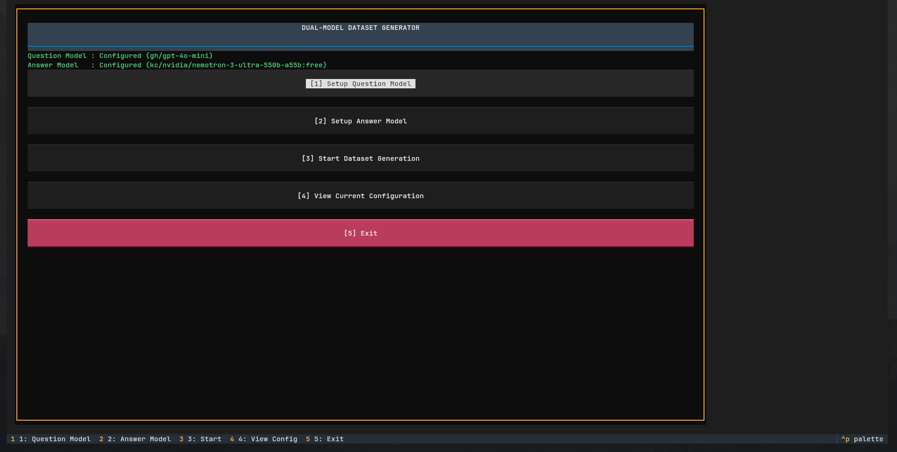

---

### 2. Configure the Question Model
Press `1` or click **`[1] Setup Question Model`** to configure the model responsible for generating questions:
- **Base URL**: OpenAI-compatible base URL (e.g., `https://api.openai.com/v1`, `https://api.groq.com/openai/v1`, `http://localhost:11434/v1`).
- **API Key**: Your provider API key (hidden with password masking).
- **Model ID**: The exact model identifier supported by your provider.

Click **Test Connection** to validate the parameters, then click **Save Configuration**.

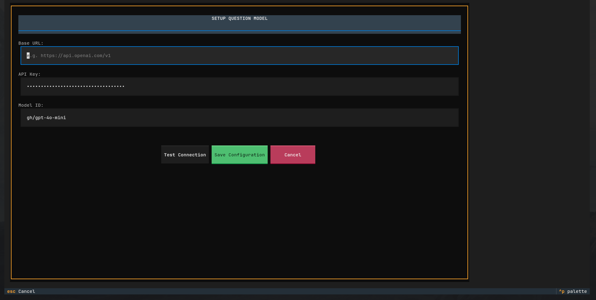

---

### 3. Configure the Answer Model
Press `2` or click **`[2] Setup Answer Model`** to configure the model responsible for answering each generated question. You can use a completely different provider, endpoint, and model size than the Question Model.

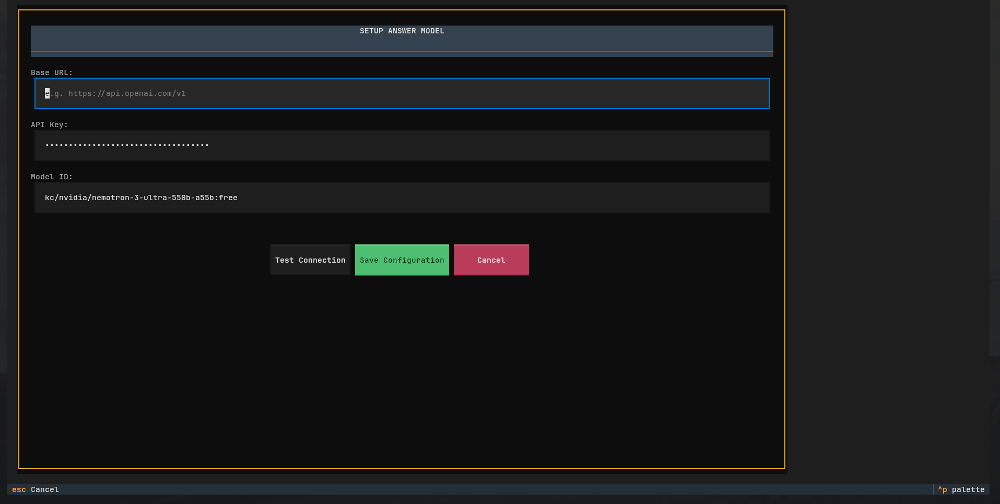

---

### 4. Configure Dataset Generation
Once both models show `Configured`, press `3` or click **`[3] Start Dataset Generation`** to open the generation setup form.

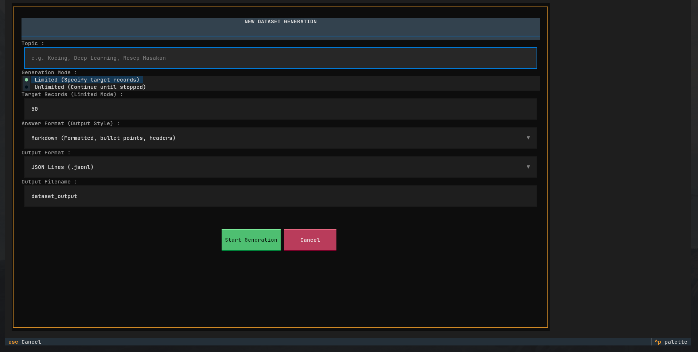

Configure the following options:

1. **Topic**: Enter a keyword, phrase, or detailed description of the subject matter.
2. **Generation Mode**: Choose between **Limited** (stops after `Target Records`) or **Unlimited** (runs continuously until stopped).

   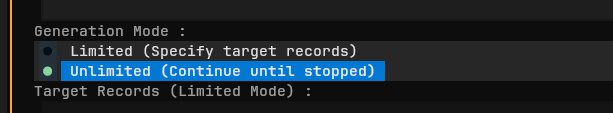

3. **Answer Format (Output Style)**: Choose how the Answer Model formats its responses — **Markdown**, **Plain Text**, or **JSON**.

   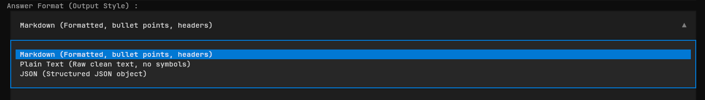

4. **Output Format**: Choose the export file format — **JSON Lines (`.jsonl`)**, **JSON Array (`.json`)**, **CSV (`.csv`)**, or **Excel (`.xlsx`)**.

   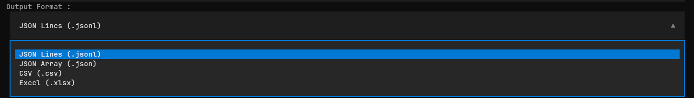

5. **Output Filename**: Base filename saved inside the `output/` directory (extension is added automatically).

Example of a completed setup form ready to run:

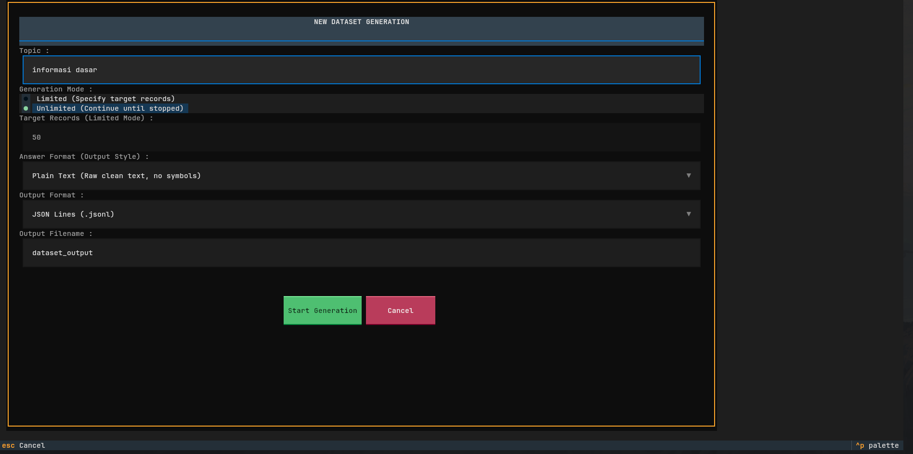

Click **Start Generation** to begin.

---

### 5. Monitor Live Generation Progress
Once started, the **Generation In Progress** screen displays job metadata, current pipeline stage, progress bar, counters, and live split-screen logs:

- **Stage 1 — Generating Question Batch**: The Question Model generates a batch of diverse, deduplicated questions.

  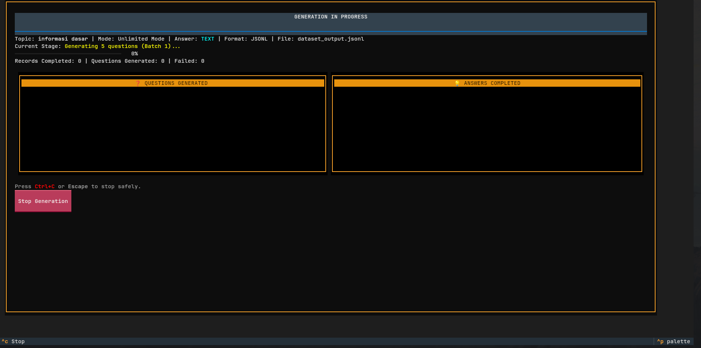

- **Stage 2 — Answering Questions Sequentially**: Generated questions populate the left panel while the Answer Model processes each question one by one.

  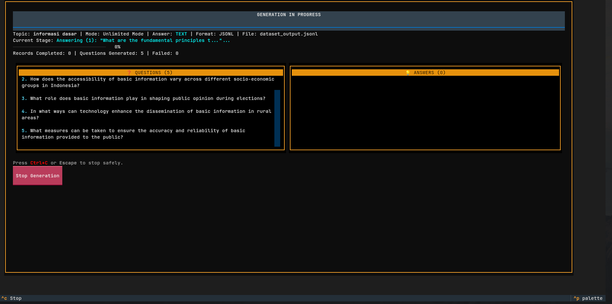

- **Stage 3 — Streaming Completed Answers**: Completed answers appear in the right panel and are immediately written to `output/<filename>.<format>`.

  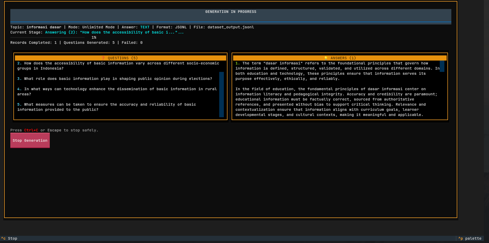

Press **`Ctrl+C`**, **`Escape`**, or click **Stop Generation** at any time to halt safely. All records completed before stopping remain saved on disk.

---

## Output Record Schema

Each saved record contains the following fields:

```json
{
  "id": 1,
  "topic": "informasi dasar",
  "question": "What are the fundamental principles...",
  "answer": "The term \"dasar informasi\" refers to...",
  "status": "completed",
  "created_at": "2026-11-20T08:23:10.123456+00:00"
}
```

If an individual answer request fails, the record is logged with `"status": "answer_failed"` and an empty `"answer"` so the pipeline can continue without interrupting the entire job.

---

## Project Structure

```text
PerfomaCollect/
├── main.py                              # Application entry point
├── pyproject.toml                       # Package metadata and dependencies
├── requirements.txt                     # Python dependency list
├── LICENSE                              # MIT License
├── README.md                            # Project documentation
└── src/
    ├── main.py                          # CLI bootstrapper
    ├── config/
    │   ├── config_manager.py            # Local JSON config persistence
    │   └── schema.py                    # Pydantic config models
    ├── generation/
    │   └── pipeline.py                  # Dual-model API pipeline & file writers
    ├── tui/
    │   ├── app.py                       # Main Textual application
    │   ├── styles.tcss                  # TUI styling
    │   └── screens/
    │       ├── main_menu.py             # Main menu & status badges
    │       ├── model_setup.py           # Question & Answer model setup forms
    │       ├── generation_setup.py      # Dataset generation parameters form
    │       ├── progress.py              # Live split-screen generation monitor
    │       └── view_config.py           # Read-only configuration viewer
    └── images/                          # Application screenshots (1.png – 11.png)
```

---

## Keyboard Shortcuts

| Screen | Shortcut | Action |
|---|---|---|
| Main Menu | `1` / `2` | Setup Question / Answer Model |
| Main Menu | `3` | Start Dataset Generation |
| Main Menu | `4` | View Current Configuration |
| Main Menu | `5` or `q` | Exit Application |
| Setup Screens | `Escape` | Cancel and return to Main Menu |
| Progress Screen | `Ctrl+C` or `Escape` | Stop generation gracefully |

---

## License

This project is licensed under the **MIT License** — see the [LICENSE](LICENSE) file for details.
